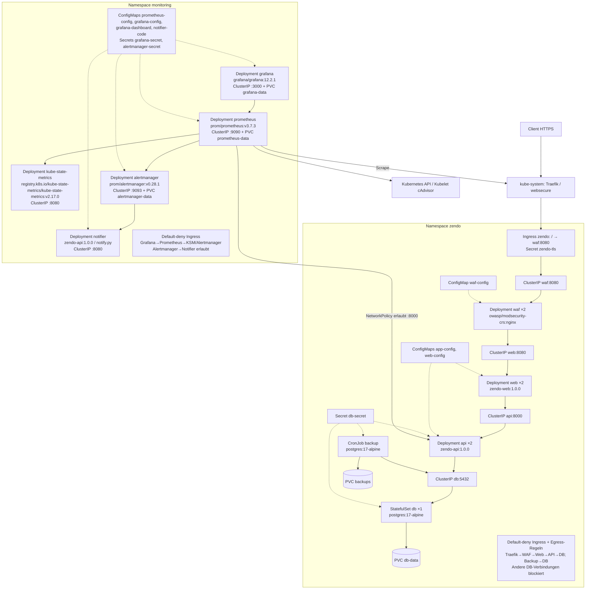
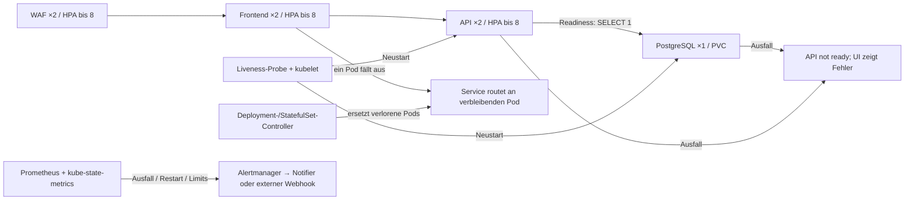

# Zendo – Projektmanagement auf Kubernetes

## Anwendungskonzept

Zendo hilft kleinen Projektteams, Projekte und Aufgaben zu planen, auf einem Kanban-Board zu bearbeiten und ihren Fortschritt als PDF zu dokumentieren. Ohne Anmeldung existiert ein gemeinsamer Workspace. Diese Demo gehört in ein vertrauenswürdiges Labornetz; alle Besucher können Daten bearbeiten.

Die drei fachlichen Schichten sind getrennt deploybar: Das **Frontend** (HTML/CSS/JavaScript, Nginx) stellt Dashboard, Board, Listen, Filter und Formulare bereit. Das **Backend** (Python/FastAPI, asyncpg) validiert Eingaben, koordiniert konkurrierende Änderungen über Versionsnummern, nimmt Lasttestdaten an und erzeugt PDF-Berichte. **PostgreSQL** persistiert Workspace und Eingangsdatensätze. Die Trennung erlaubt unabhängiges Skalieren der zustandslosen Web-/API-Schichten; die Datenbank liegt auf einem PVC. Asynchrones I/O und Streaming verhindern, dass jeder 5-MiB-Request vollständig im API-Speicher gehalten werden muss.

Funktionale Anforderungen: Projekte/Aufgaben inklusive Teilaufgaben verwalten; Status per Drag-and-drop ändern; nach Priorität und Text filtern; Berichte nach Projekt/Fälligkeit filtern und als echtes PDF herunterladen. Nichtfunktionale Anforderungen: persistente Daten über Pod-Neustarts; Fehlermeldungen bei DB-/API-Ausfall; horizontale Skalierung; TLS und Netzwerktrennung; messbare Betriebszustände.

Der langlaufende Endpunkt `POST /api/reports/generate` liest den gespeicherten Workspace und erzeugt ein PDF. Eine asynchrone Wartephase von standardmäßig **2 Sekunden** simuliert eine aufwendige Aggregation. Die PDF-Erzeugung läuft in einem Thread. Pro API-Pod werden höchstens 16 Berichte gleichzeitig verarbeitet, darüber folgt HTTP 429 mit Retry-After. Dies macht Skalierungsunterschiede messbar, statt unter Last unbeschränkt Arbeit anzunehmen. Normale Dateneingänge verwenden den separaten Streaming-Endpunkt `/api/submissions` ohne künstliche Verzögerung.

## Lokal mit Docker starten

Voraussetzungen: Docker Desktop (Linux-Container), Python 3.10+.

```powershell
python scripts/setup.py
docker compose up -d --build
python tests/integration.py
```

Aufruf: **http://localhost:8080**. Zuerst ein Projekt und dann Aufgaben erstellen. Karten anklicken zum Bearbeiten oder zwischen Statusspalten ziehen. Unter **Berichte & PDF** Filter setzen und **Als PDF speichern** wählen. Die Anwendung verwendet jetzt die Datenbank, nicht mehr den Browser als Hauptspeicher. Vorhandene Daten der bisherigen Browser-Version werden bei einem noch leeren Server-Workspace automatisch übernommen; die lokale Kopie bleibt bestehen.

`docker compose down` stoppt die Anwendung; das DB-Volume bleibt bestehen. `docker compose down -v` würde es löschen. Compose ist die lokale Funktionsumgebung; TLS, WAF und Monitoring werden im vollständigen Kubernetes-Stack betrieben.

## Kubernetes starten

Voraussetzungen: k3s mit Traefik (`IngressClass traefik`), funktionierender Standard-StorageClass, Metrics Server, CNI mit NetworkPolicy-Unterstützung, Docker und kubectl. Der Namespace `monitoring` muss frei sein bzw. für diese Abgabe bereitstehen. Der Stack verwendet dort eigene Deployments; kein Helm-Operator ist erforderlich. Pro Cluster für diese Demo mindestens etwa 4 CPU / 6 GiB verfügbaren Speicher einplanen, für die großen Lasttests deutlich mehr. HPA benötigt die Metrics API.

### Images für den Gruppencluster

Eigene Images bauen, unter einem unveränderlichen Versions-Tag in eine für alle Nodes erreichbare Registry laden (Beispielpräfix ersetzen):

```powershell
docker build -t ghcr.io/GRUPPE/zendo-web:1.0.0 .
docker build -t ghcr.io/GRUPPE/zendo-api:1.0.0 backend
docker push ghcr.io/GRUPPE/zendo-web:1.0.0
docker push ghcr.io/GRUPPE/zendo-api:1.0.0
kubectl config current-context
python scripts/setup.py --kubernetes --registry ghcr.io/GRUPPE --domain zendo.local
```

Die Registry muss öffentlich lesbar sein oder clusterseitig ImagePullSecrets erhalten. Das Setup arbeitet im angezeigten **aktuellen kubectl-Kontext**. Es erzeugt zufällige Passwörter in `.secrets/`, legt Secrets einschließlich TLS an und wendet alle Ressourcen deklarativ an. Tabellen werden vom Backend automatisch und wiederholbar initialisiert. Für nachfolgende Änderungen kann nach der Secret-Initialisierung `kubectl apply -f k8s/` verwendet werden; bei Registry-/Domain-Abweichungen erneut das Setup ausführen, da dieses die ausgelieferte Basis im Speicher anpasst.

Für einen lokalen k3d-Testcluster ohne Registry:

```powershell
k3d cluster create zendo-lab --agents 2 -p "8443:443@loadbalancer"
python scripts/setup.py --kubernetes --local-k3d zendo-lab --domain zendo.local
```

DNS bzw. hosts-Datei: `zendo.local` auf die erreichbare Ingress-IP setzen (lokal 127.0.0.1). **Gruppencluster: https://zendo.local**, lokaler k3d-Port: **https://zendo.local:8443**. Das selbstsignierte Zertifikat im Browser akzeptieren oder der lokalen CA-Vertrauensliste hinzufügen. Ingress ist ausschließlich am TLS-EntryPoint erreichbar; interne Dienste verwenden ClusterIP. Health-URL: **https://zendo.local/api/health** (lokal Port 8443).

Die YAML-Datei enthält JSON-Syntax, eine gültige YAML-Teilmenge. Quelle: `scripts/generate_infra.py`; `python scripts/generate_infra.py` regeneriert sie. Konfigurationen liegen in ConfigMaps; Kennwörter, TLS-Key und externe Webhook-URL in Secrets. `.secrets/` wird nicht versioniert. Bei Wiederherstellung einer vorhandenen DB muss ihr bisheriges Passwort verwendet werden: Secrets nicht unabhängig von den Daten neu generieren.

## Endpunkte

| Methode / Pfad | Verhalten |
|---|---|
| `GET /` | Projekt-Webanwendung |
| `GET /api/live` | Prozess lebt, ohne DB-Abhängigkeit |
| `GET /api/ready`, `/api/health` | DB-Abfrage, 503 bei Ausfall |
| `GET /api/workspace` | Projekte, Aufgaben und Versionsnummer |
| `PUT /api/workspace` | Workspace inkl. `version` speichern, 409 bei Änderungskonflikt |
| `POST /api/submissions` | Streaming-Eingang bis 6 MiB; persistiert Größe, SHA-256 und Zeit, antwortet mit ID |
| `POST /api/reports/generate` | JSON `{"project":"all","from":"","to":""}`, PDF nach mindestens 2 s |
| `GET /metrics` | interne Prometheus-Metriken; nicht per Web-Proxy exponiert |

```powershell
curl.exe -k -X POST https://zendo.local/api/submissions -H "Content-Type: application/octet-stream" --data-binary "Belegarbeit"
curl.exe -k -X POST https://zendo.local/api/reports/generate -H "Content-Type: application/json" -d '{}' -o bericht.pdf
```

## Diagramm 1: Architektur und Datenfluss



Alle Services sind ClusterIP. Registrypräfixe werden vom Setup auf die eigenen Images angewendet. Zusätzlich referenziert die WAF die ConfigMap waf-config für Streaming und die gezielte Ingestion-Ausnahme. Externe Webhooks verlassen ausschließlich die Monitoring-Schicht. Monitoring hat Zugriff auf Cluster-Metriken über ein lesendes ServiceAccount/RBAC.

## Diagramm 2: Abhängigkeiten und Resilienz



Kubernetes garantiert keine starre Startreihenfolge: DB-Initialisierung erfolgt im DB-Container, die API wartet mit Wiederholungen auf die DB und wird erst nach erfolgreicher Initialisierung bereit. Nginx behält bei API-Ausfall die statische Oberfläche erreichbar; fehlgeschlagene API-Requests werden sichtbar gemeldet. Startup-Probe gewährt der API Initialisierungszeit. Readiness nimmt einen Pod aus dem Load Balancing; Liveness startet einen hängenden Prozess neu. DB-Liveness prüft den Prozess mit pg_isready, DB-Readiness führt authentifiziert SQL aus. Web-Liveness liefert einen Prozessstatus, Readiness prüft index.html. Monitoring nutzt jeweils Health- und Ready-Endpunkte; Grafana TCP vs. DB-Health.

## Monitoring und Alarmierung

```powershell
kubectl -n monitoring port-forward svc/grafana 3000:3000
# http://localhost:3000 – Benutzer admin, Passwort aus .secrets/admin_password
kubectl -n monitoring port-forward svc/prometheus 9090:9090
kubectl -n monitoring logs -f deployment/notifier
```

Das Dashboard **Zendo Infrastruktur** und der Prometheus-Datasource werden automatisch provisioniert. Prometheus erfasst alle API-Pods dynamisch, Kubernetes-Zustände über kube-state-metrics und CPU/RAM über den authentifizierten Kubelet-Proxy. Traefik muss Prometheus-Metriken am benannten Container-Port `metrics` anbieten (bei k3s standardmäßig prüfen; ggf. über die clusterverwaltete Traefik HelmChartConfig aktivieren). Fehlende Scrape-Targets dürfen bei der Abnahme nicht als Null-Auslastung interpretiert werden.

| Metrik | Quelle | Schwellwert / Aktion |
|---|---|---|
| Backend / DB verfügbar | up / zendo_database_up | 30 s ausgefallen → kritisch |
| Pod Ready | kube-state-metrics | 1 min nicht bereit → Warnung |
| Container-Neustarts | kube-state-metrics | Zunahme innerhalb 5 min → Warnung |
| Verfügbare vs. Soll-Replicas | kube-state-metrics | Differenz 1 min → kritisch |
| API CPU | cAdvisor | > 1,4 Kerne für 2 min → Warnung; HPA ab 65 % des Requests |
| API RAM | cAdvisor | > 450 MB für 2 min → Warnung, Limit 512 MiB |
| Berichtslatenz p95 | API Histogramm | > 5 s für 2 min → Warnung |
| Ingress 5xx | Traefik | > 5 % für 1 min → kritisch |
| Backup-Job fehlgeschlagen | kube-state-metrics | > 0 für 1 min → kritisch |

Alertmanager sendet standardmäßig an einen **unabhängigen internen Notifier**, der Benachrichtigungen als JSON in seine Logs schreibt. Für echte externe Zustellung Setup mit `--webhook https://EMPFÄNGER/...` ausführen (Alertmanager-Webhookformat, nicht automatisch Slack-Format). URL bleibt in einem Secret. Zuständigkeit: Betriebsteam/Projektgruppe prüft Warnungen, kritische Ausfälle sofort; anhaltende DB-/PVC-/ImagePull-Probleme erfordern manuellen Eingriff. Externer Empfänger und Rufbereitschaft müssen von der Gruppe konkret benannt werden. Konfigurationsänderungen: `kubectl rollout restart deployment/NAME -n monitoring`.

## Betrieb, Updates und Backups

Web, API und WAF starten mit zwei Replikaten; HPA skaliert CPU-basiert bis acht. Ressourcenrequests und -limits sind für jeden Container gesetzt. PDB schützt gegen gleichzeitige freiwillige Ausfälle, ersetzt jedoch keine Ausfallsicherheit bei zu wenigen Nodes.

```powershell
kubectl -n zendo set image deployment/api api=ghcr.io/GRUPPE/zendo-api:1.0.1
kubectl -n zendo rollout status deployment/api --timeout=300s
kubectl -n zendo rollout history deployment/api
kubectl -n zendo rollout undo deployment/api
kubectl -n zendo rollout status deployment/api
```

RollingUpdate verwendet maxUnavailable=0, maxSurge=1, minReadySeconds=5, eine 10-s-Drainphase und 75 s Terminierungsfrist. Uvicorn wartet bis 45 s auf laufende Requests. Kein DB-Migrationsschritt darf die vorherige Version inkompatibel machen. Null verlorene Requests ist als Testziel unter realer Last zu prüfen, keine Garantie bei Netzwerkausfällen oder Kill -9.

Backups laufen alle 6 Stunden als CronJob mit pg_dump -Fc, atomarem Umbenennen und 7 Tagen Aufbewahrung auf dem Backup-PVC. DB-Daten und Backups sind nicht im Image. Restore in eine leere Testdatenbank mit `pg_restore --clean --if-exists --no-owner`; Beispiel im Backup-Pod mit gemountetem Secret: `PGPASSWORD=$(cat /run/secrets/db_password) pg_restore -h db -U zendo -d zendo --clean --if-exists /backups/DATEI.dump`. Vor Restore API stoppen und vorhandene Daten sichern. Backups sind lokal zum Cluster; gegen kompletten Node-/Clusterverlust auf getrennten Storage exportieren.

## Last-, Ausfall- und Sicherheitstests

Integrationstest: `python tests/integration.py https://zendo.local` (lokal mit :8443). Er schreibt normale Dateneingänge, erhält vorhandene Workspace-Inhalte und prüft Konflikte, 10 parallele 5-MiB-Requests und echte PDF-Antworten mit Mindestlaufzeit.

Mit Docker: `./scripts/load-matrix.ps1 -BaseUrl https://zendo.local`. Die großen Bodies werden von einem speichersparenden Python-Streaming-Generator gesendet, die übrigen Fälle mit k6. Die Matrix deckt alle Web-/Daten-Endpunkte aus der Bewertung ab: 10/0 s, 100/1 s, 1000/5 s, Web zusätzlich 1000/1 s und 1000/min für 10 min. Große Bodies sind jeweils 5 MiB; der strenge Test verlangt HTTP 200 auch bei 1000 Requests (damit zugleich strenger als der Fall, der 429 erlaubt). Rohdaten stehen unter artifacts/load. Host, Netzwerk und Lastgenerator müssen >5 GiB pro großem Test übertragen können; Timeouts und Ressourcen entsprechend auf Basis von Messungen dimensionieren.

Für den strengen 1000 × 5-MiB-Test zuerst `kubectl apply -f infrastructure/high-load.yaml` ausführen und acht bereite WAF-Pods abwarten (`kubectl -n zendo rollout status deployment/waf`). HPA reagiert nicht innerhalb eines 5-Sekunden-Bursts; ohne vorbereitete Kapazität kann der Kaltstart die WAF-Speicherlimits überschreiten. Nach dem Test mit dem regulären Setup die normalen HPA-Grenzen wiederherstellen. Das binäre, ausschließlich gehashte Ingestion-Format wird auf `/api/submissions` von der WAF nur anhand der Header geprüft; Request-Body-Prüfung ist dort zur Streaming-Unterstützung gezielt deaktiviert. Die vollständigen CRS-Inhaltsregeln bleiben auf Workspace, Berichten und übrigen Routen aktiv.

Lokale vollständige Matrix ohne Windows-Portforward als zusätzlichen Engpass:

```powershell
python scripts/load_docker.py --network k3d-zendo-validation --loadbalancer k3d-zendo-validation-serverlb
```

Das lokale Setup hebt die Verbindungsgrenze des k3d-Loadbalancers auf 8192 an. `infrastructure/traefik-k3s.yaml` konfiguriert 300-s-Timeouts für große Uploads. Bei eigenen k3s-Clustern vorab mit dem Betriebsteam abstimmen und per `--configure-traefik` anwenden; bestehende Traefik HelmChartConfig-Werte zusammenführen. Dies ist eine clusterweite Infrastrukturkonfiguration, kein App-Deployment.

Automatisierter Skalierungsvergleich im lokalen Testcluster: `python scripts/scale_test.py`. Er verwendet 16 virtuelle Nutzer über 30 Sekunden, vier gleichzeitige Berichte pro Pod und wertet erfolgreiche Berichte separat von kontrollierten 429-Antworten aus. Währenddessen keine zusätzlichen Großlasttests starten.

Manuelle Variante:

```powershell
kubectl -n zendo delete hpa api
kubectl -n zendo scale deployment/api --replicas=1
kubectl -n zendo rollout status deployment/api
k6 run -e BASE_URL=https://zendo.local -e MODE=report -e VUS=16 -e OUTPUT=artifacts/report-1.json tests/load.js
kubectl -n zendo scale deployment/api --replicas=3
kubectl -n zendo rollout status deployment/api
k6 run -e BASE_URL=https://zendo.local -e MODE=report -e VUS=16 -e OUTPUT=artifacts/report-3.json tests/load.js
```

Der belastbare Vergleich verwendet `tests/report_scale.js`, nicht den einmaligen Burst. Siehe automatisiertes Skript und gemessene Ergebnisse in docs/PRUEFUNG.md.

Für Ausfalltests während Dauerlast einen Web-Pod löschen; API bzw. DB separat auf 0 skalieren, Health/Frontend/Alerts prüfen und danach auf API=2 / DB=1 zurücksetzen. Persistenz: Aufgabe anlegen, DB-Pod löschen, Aufgabe nach Wiederanlauf erneut abrufen. WAF: `curl.exe -k "https://zendo.local/?q=<script>alert(1)</script>"` muss blockiert werden. NetworkPolicy: DB-Verbindung aus einem nicht berechtigten Test-Pod muss scheitern; von API/Backup muss sie funktionieren. Ingress-TLS überprüfen. Kritische Scans: `./scripts/scan.ps1`, Ergebnisse in artifacts/scans; Exitcode ungleich 0 verlangt Behebung/erneute Prüfung.

Die Images laufen Non-Root; die eigenen App-Container und Monitoring verwenden read-only Root-Filesystem, temporäre tmp-Volumes und entfernte Capabilities. WAF ist eine dokumentierte Ausnahme zum read-only Root-Filesystem, weil das offizielle Image Konfiguration beim Start schreibt. In Kubernetes blockieren NetworkPolicies direkte DB-Zugriffe sowie unnötige App-Egress-Verbindungen. Geheimnisse werden als Dateien gemountet und stehen nicht als Klartext-Umgebungsvariablen in docker inspect/ConfigMaps. Kubernetes-Secrets sind ohne zusätzliche Cluster-Verschlüsselung lediglich base64-kodiert; RBAC und Secret-Encryption liegen beim Clusterbetrieb.

## Abgabe und Nachweise

[Anforderungsmatrix](docs/ANFORDERUNGEN.md) · [Tatsächliche Prüfergebnisse](docs/PRUEFUNG.md)

Quellen: [Kubernetes Probes](https://kubernetes.io/docs/concepts/workloads/pods/probes/), [Rolling Updates](https://kubernetes.io/docs/tasks/run-application/update-deployment-rolling/), [Prometheus Konfiguration](https://prometheus.io/docs/prometheus/latest/configuration/configuration/), [Alertmanager](https://prometheus.io/docs/alerting/latest/configuration/), [OWASP CRS Container](https://github.com/coreruleset/modsecurity-crs-docker).
